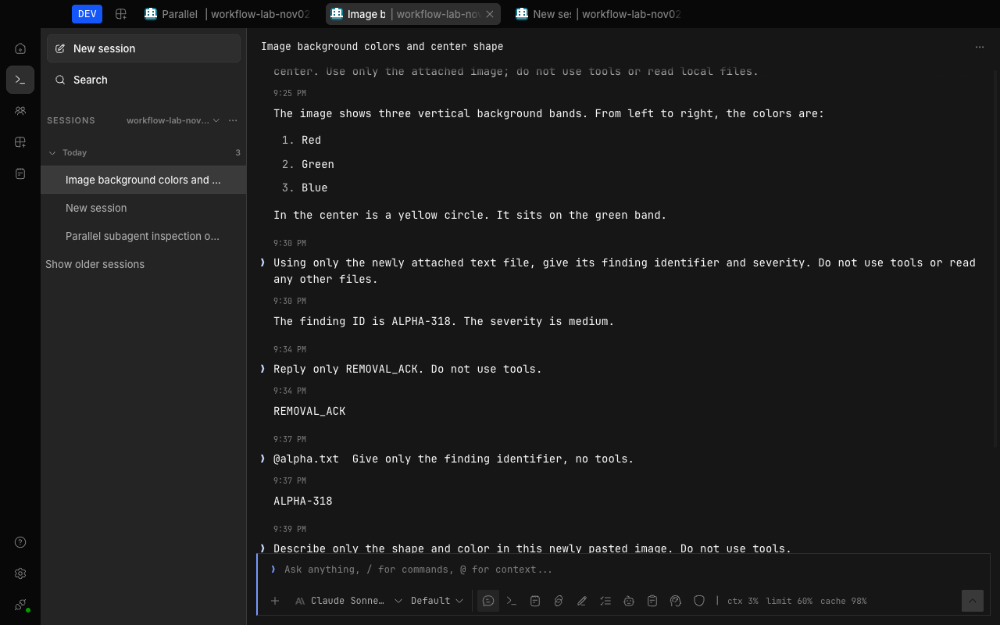
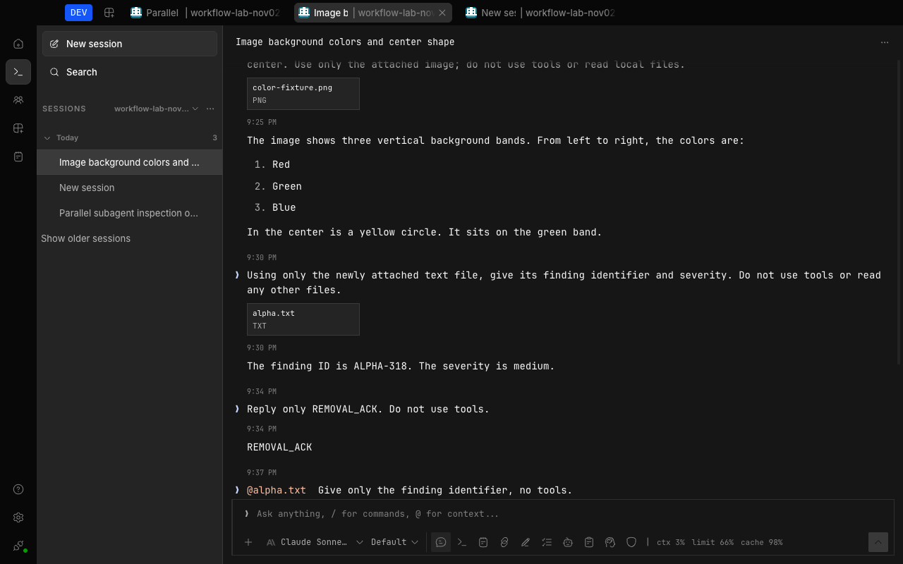

# Session attachment testing

Check the sent transcript as well as the model's response when testing attachments. Desktop picker files can persist as
`file:` references, while pasted images can persist as `data:` URLs. A model receiving the bytes does not prove that the
user can still see what was attached.

## Display and action boundaries

- Non-inline file references render as filename/type cards, including image references. They are not embedded as raw
  local-file images and do not trigger an automatic file read or remote fetch.
- Embedded data images keep their thumbnail and image-preview dialog. File mentions retain their source ranges and stay
  inline rather than acquiring duplicate cards.
- File-reference cards are actionable only when the session's owning server is local, the filename is absolute, and the
  desktop provides native reveal support. Other file-reference cards remain visible but noninteractive. This decision
  uses the route's server, not the globally selected server.
- Failed native reveal reports an error rather than falling back to a `file:` download. A saved path can become stale;
  displaying the card does not prove the file still exists.

## Regression fixture

From `packages/session-ui`:

```sh
bun test src/components/message-file.test.ts
```

From `packages/app`:

```sh
bun test --conditions=solid --conditions=browser --preload ./happydom.ts ./test-browser/sent-file-cards.test.ts
```

The browser fixture projects persisted messages and mounts `UserMessageDisplay`. It covers filename cards, inline mention
spans, data-image preview invocation, attachment-only messages, disabled cards, and route-scoped native actions with
controlled platform callbacks. It does not exercise the operating system's file picker or Finder.

## Desktop acceptance

Use disposable files and an isolated test profile.

1. Choose **Add files and more > Images and files**, attach a small PNG, and ask the model to describe it without tools.
   Check the persisted file reference and the sent message's filename/type card, not just the answer.
2. Repeat with a text file and with an image-only message. Navigate away and back, then reload; the cards must remain.
3. Click a local file card and verify native reveal receives the intended path. Missing files must not trigger a raw
   file-URL download.
4. Paste an image and verify its thumbnail and preview still work. Add and remove a file before sending another message;
   that message must contain no attachment. Select an actual `@` file suggestion and verify it remains an inline reference.

The screenshots below were captured November 2, 2026 from real Claude Sonnet 5.5 sessions. The PNG and text file reached
the model in both cases; only the presentation differs.





## Limits

File-reference cards are not portable snapshots or remote downloads. Their actions do not establish that an old path
still identifies the original file. The native reveal comparison covers a local macOS desktop; the browser fixture
checks route selection and unavailable-platform behavior without a live remote server.

The browser fixture has two test-only baseline controls: `ATTACHMENT_BASE_COMPONENT` supplies a saved message component
for its Babel loader, and `ATTACHMENT_ROUTE_RED` skips the earlier disabled-card assertions to isolate a route-selection
failure. Leave both unset for normal regression runs. Neither is application configuration.

## Source

- Attachment classification: [`message-file.ts`](../../packages/session-ui/src/components/message-file.ts).
- User-message display: [`message-part.tsx`](../../packages/session-ui/src/components/message-part.tsx).
- Persisted-message projection: [`session-v2-presentation.ts`](../../packages/app/src/pages/session/goal/session-v2-presentation.ts).
- Explicit actions: [`attachment-actions.ts`](../../packages/app/src/pages/session/attachment-actions.ts), wired by
  [`session.tsx`](../../packages/app/src/pages/session.tsx).
- Mounted regression: [`sent-file-cards.test.ts`](../../packages/app/test-browser/sent-file-cards.test.ts).
