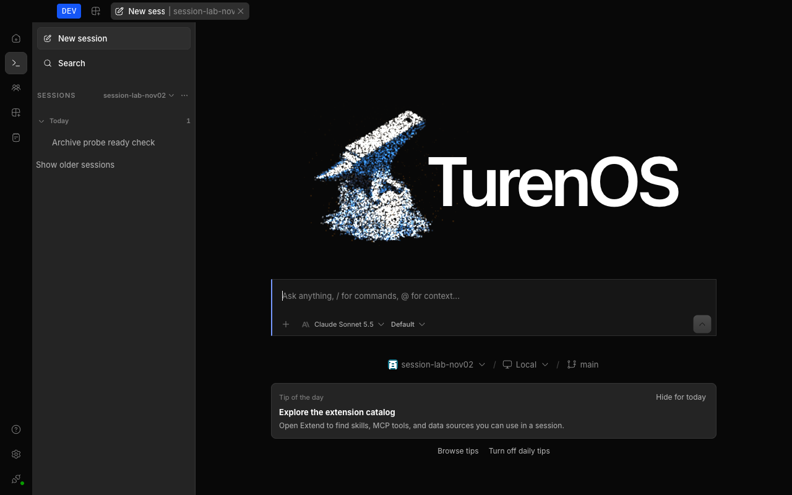
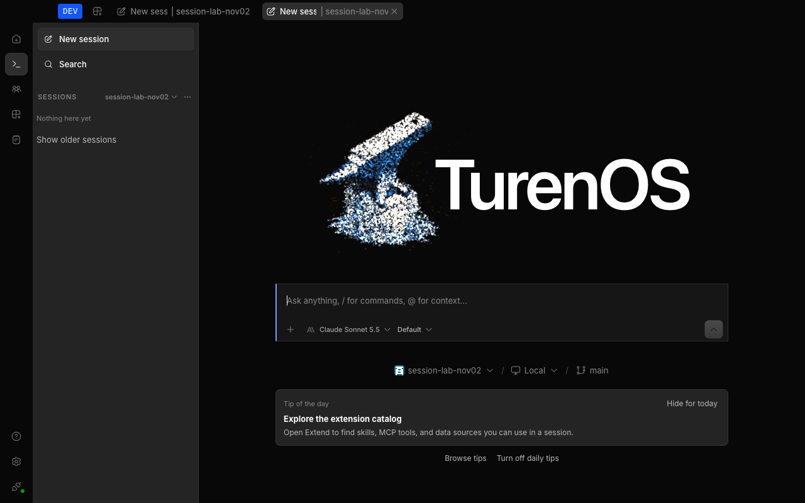

# Session removal testing

Archive and delete actions in a conversation must update the server's Home session index after the HTTP request succeeds.
The Agents sidebar reads that index independently of the conversation's per-directory store; a delayed global event must
not leave the removed session visible. Failed requests must leave it visible.

## Regression fixture

From `packages/app`, run:

```sh
bun test --conditions=solid --conditions=browser --preload ./happydom.ts ./test-browser/timeline-session-removal.test.ts
```

The browser-condition fixture mounts `MessageTimeline`, opens its menu, and exercises archive and confirmed delete with
stubbed request boundaries and real Home index caches. It checks successful removal, rejected requests, an unrelated
session, a second server with the same session IDs, and descendant eviction for delete. It is not a live server test.

For baseline comparisons, the fixture's test-only `TIMELINE_BASE_SOURCE` environment variable accepts an absolute path to
an unchanged timeline source file. The fixture compiles that file instead of the working-tree timeline; no production
source replacement is needed.

## Desktop acceptance

Use a disposable project and test profile, not sessions containing real work. Deleting a session is irreversible.

1. Start a real model conversation and wait for its answer. Give the session a recognizable title and confirm its sidebar row.
2. Through Chrome DevTools Protocol request-stage interception, hold the next real `/global/event` reconnect. Require a
   `Last-Event-ID` header; record its presence, not authentication headers. Leave other requests and the per-session stream
   untouched.
3. Choose **More options > Archive** in the conversation header. The sidebar row must disappear without a reload or a
   global event. Read the session back to confirm that its archive timestamp was saved.
4. Repeat with another real conversation using **More options > Delete...**, then confirm **Delete**. Its row must disappear;
   reading that session back must return not found.
5. Release interception in cleanup even if an assertion fails. Verify that ordinary navigation still works.

Screenshots captured November 2, 2026 in an isolated development instance, using real Claude Sonnet 5.5 conversations:

Without the local index update, archive succeeded on the server but left the row visible while the reconnect was held:



With the update, the sidebar no longer contains the archived session under the same delayed-event condition:



## Limits

These checks cover removal initiated from the conversation menu. They do not prove global-event delivery reliability,
reconnection ordering, or changes initiated by another client. The desktop comparison exercises the renderer change;
server archive and delete behavior is unchanged.

## Source

- Conversation actions: [`message-timeline.tsx`](../../packages/app/src/pages/session/timeline/message-timeline.tsx).
- Sidebar index: [`home-session-index.ts`](../../packages/app/src/context/global-sync/home-session-index.ts).
- Archive event helper: [`home-session-archive.ts`](../../packages/app/src/pages/home-session-archive.ts).
- Regression entry point: [`timeline-session-removal.test.ts`](../../packages/app/test-browser/timeline-session-removal.test.ts).
