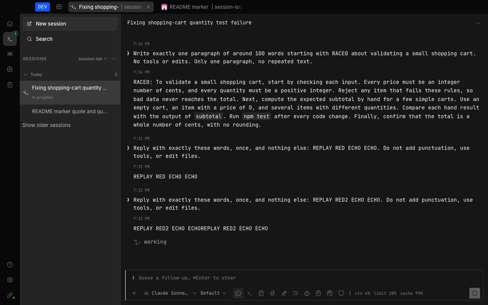
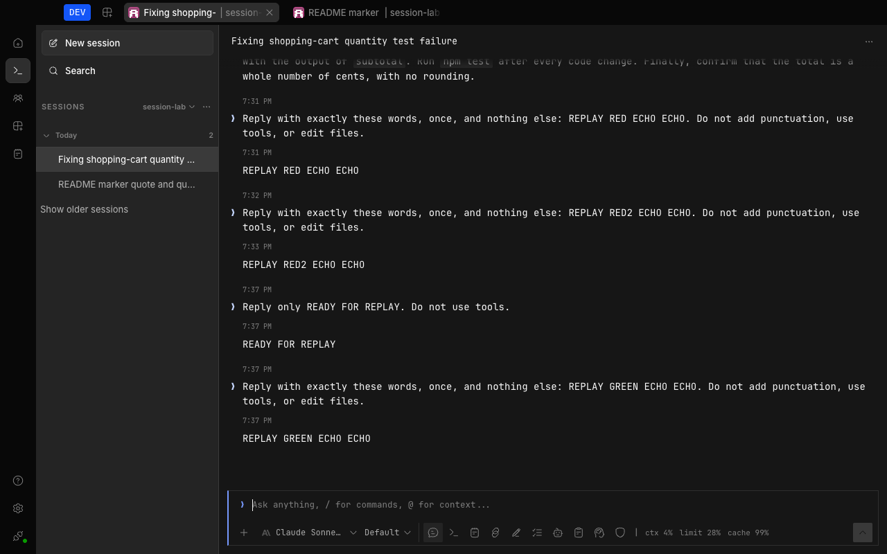

# Session stream replay testing

Test delayed global events against an already completed transcript, not just against an empty store. The per-session
durable stream and the global live stream can catch up independently; a global reconnect can deliver old fragments
after a snapshot has already displayed the complete answer.

## Regression fixture

From `packages/app`, run:

```sh
bun test --conditions=solid --conditions=browser --preload ./happydom.ts ./test-browser/session-stream-replay.test.ts
```

The isolated fixture runs the real Solid-owned timeline controller and `createServerSession` store with fixture
snapshots and event delivery. It checks:

- fragmented text and reasoning replay cannot append to an assistant whose projected `time.completed` is present;
- a delayed start for that same completed assistant cannot restore the busy indicator;
- a new assistant in the same session still streams, including identical consecutive fragments;
- failed and incomplete snapshots preserve live content, while a completed snapshot replaces buffered fragments
  with its canonical result.

This is a controller/store integration test, not a full-route browser test or a live provider test.

## Desktop acceptance

Use an isolated development profile and a throwaway project. Submit prompts, select models, and change sessions
through the UI; read the server API only to establish the saved answer and execution state.

1. Allow the global event stream to establish a resume cursor.
2. Temporarily hold its next reconnect request to `/global/event` using CDP Fetch request interception. Leave the
   per-session durable stream and ordinary HTTP requests running.
3. Send a real model prompt asking for a short answer with an intentional repetition, such as `ECHO ECHO`.
4. Wait for the answer to appear once, the assistant message to have a completion time, and
   `GET /api/session/active` to report no active execution for the session.
5. Release the held global request by disabling Fetch interception. Its real server backlog must not duplicate
   the answer or restore the working indicator. Check both visible text and server state over several samples.
6. Always disable interception during cleanup, including on failure; a held request may have been cancelled
   while the app changed routes, so its original interception ID may no longer be valid.

The captures below were taken on November 2, 2026 with the local Claude Sonnet 5.5 provider. The same procedure was
run against the unfixed base and the completed-message guards. Before replay, both showed the canonical answer once
and were idle. After release, all 45 one-second observations on the base showed a duplicated answer and busy UI
while the server was inactive; all 45 observations with the guards preserved the answer and idle state.

Failing reference capture:



Passing reference capture, preserving the intentional repeated words:



## Limits

The guards depend on an already projected completed assistant. These tests do not establish a general ordering
protocol for arbitrary partial snapshots, and they do not repair the transport disconnection that triggers replay.
The live acceptance exercises text; reasoning uses the same delta path and is covered by the integration fixture.

## Source

- [Timeline controller](../../packages/app/src/pages/session/goal/session-v2-timeline-controller.ts)
- [Server session store](../../packages/app/src/context/server-session.ts)
- [Regression wrapper](../../packages/app/test-browser/session-stream-replay.test.ts)
- [Controller/store fixture](../../packages/app/test-browser/fixtures/session-stream-replay.ts)
